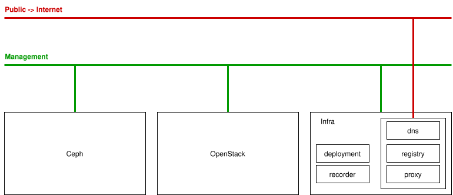
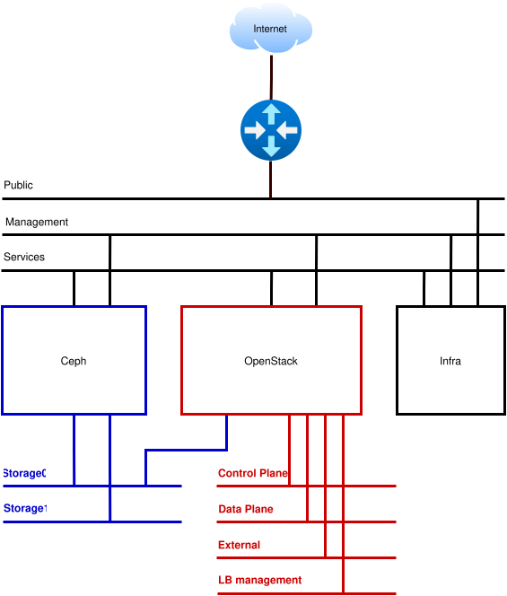
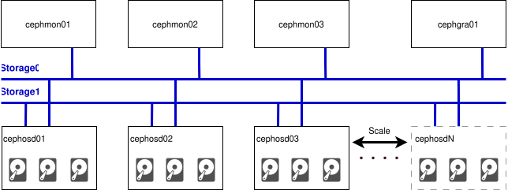

# lab-openstack

Deploy and operate a multi-node OpenStack cloud with kolla-ansible and Ceph.
The lab runs on one bare-metal host, the cluster nodes are virtual machines.

Lab description: [infraguide.org/learn/openstack](https://infraguide.org/learn/openstack/)

This repository is used to:
* Prepare the hypervisor for the test environment
* Create the networks for the environment
* Build the VM-based environment for the workshop
* Create and publish the slides
* Run the workshop using the slides

## Environment
Network:



OpenStack:



Ceph:



## Slides
The slides are published on GitHub Pages: [infraguide-org.github.io/lab-openstack](https://infraguide-org.github.io/lab-openstack/)

| Deck | Content | Files |
|---|---|---|
| Deploy | Deploy and operate a multi-node OpenStack cloud | `slides-deploy` |
| Automation | Automating the cloud with cloud-init, Ansible and Terraform | `slides-automation` |
| Testing | Automated testing of the cloud | `slides-testing` |
| Introduction | OpenStack and Ceph introduction | `slides-introduction` |

Every deck is available as HTML, PDF and PPTX, for example
`https://infraguide-org.github.io/lab-openstack/slides-deploy.pdf`.
[`index.json`](https://infraguide-org.github.io/lab-openstack/index.json) lists all decks and files in a machine-readable form.
The slides are also part of [infraguide.org](https://infraguide.org/learn/openstack/).

## How to create slides
The sources are Markdown files in `slides/src`, rendered with [Marp](https://marp.app/):

```bash
cd slides/src
marp          # html
marp --pdf    # pdf
marp --pptx   # pptx
```

The output goes to `slides/dist`. Every push to `main` that changes `slides/src` or `slides/scripts`
builds the slides and publishes them with the workflow `.github/workflows/slides.yml`.
