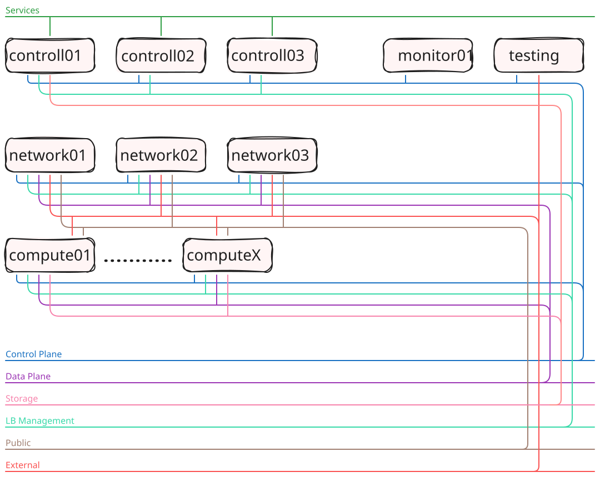

# lab-openstack

Deploy and operate a multi-node OpenStack cloud with kolla-ansible and Ceph.
The lab runs on one bare-metal host, the cluster nodes are virtual machines.

Lab description: [infraguide.org/learn/openstack](https://infraguide.org/learn/openstack/)

This repository holds the configuration, the deployment code, the modules and the slides of the lab.
The hypervisor, the networks and the virtual machines of the environment are created with
[setup-sandbox](https://github.com/infraguide-org/setup-sandbox). This repository is used to:
* Deploy OpenStack and Ceph on the virtual machines
* Create and publish the slides
* Run the workshop using the slides

## Repository layout
| Path | Content |
|---|---|
| `conf/` | `env.yaml` - network and host layout of the environment, `tmuxp.yaml` - tmux session with a window per host group |
| `deploy/kolla-ansible/` | kolla-ansible inventory (`inventory/lab`) and configuration (`custom-config/lab`) |
| `deploy/cephadm/` | cephadm configuration of the Ceph cluster |
| `modules/` | additional modules: `automation` (Ansible, Terraform, testinfra) and `testing` (Tempest) |
| `scripts/` | helper scripts for the nodes (`helpers`, `infra`) |
| `slides/` | slide sources (`src`) and the script that builds the index page and `index.json` (`scripts`) |
| `status/` | `build.yml` - result of the automatic lab build, shown on the lab page |

## Environment
Overview:



Network:


OpenStack:


Ceph:


## Slides
The slides are published on GitHub Pages: [infraguide-org.github.io/lab-openstack](https://infraguide-org.github.io/lab-openstack/)

| Deck | Content | Files |
|---|---|---|
| Introduction | OpenStack and Ceph introduction | `slides-introduction` |
| Deploy | Deploy and operate a multi-node OpenStack cloud | `slides-deploy` |
| Automation | Automating the cloud with cloud-init, Ansible and Terraform | `slides-automation` |
| Testing | Automated testing of the cloud | `slides-testing` |

Every deck is available as HTML, PDF and PPTX, for example
`https://infraguide-org.github.io/lab-openstack/slides-deploy.pdf`.
[`index.json`](https://infraguide-org.github.io/lab-openstack/index.json) lists the decks in their order, all files, the hosts of the environment (`hosts`) and the path of the environment diagram (`diagram`) in a machine-readable form.
The slides are also part of [infraguide.org](https://infraguide.org/learn/openstack/).

## Lab page
The page at [infraguide-org.github.io/lab-openstack](https://infraguide-org.github.io/lab-openstack/) and the lab page on
[infraguide.org](https://infraguide.org/learn/openstack/) are generated from files in this repository.
`slides/scripts/make-index.sh` writes the page and `index.json`, the infraguide.org build reads `index.json`.

| Section | Source | Content |
|---|---|---|
| Slides | `slides/src/*.md` | The decks, ordered by the `order` field in their front matter |
| Environment | `slides/src/assets/openstack/env.svg` | Diagram of the environment, listed as `diagram` in `index.json` |
| Hosts | `conf/env.yaml` (`server_conf`) | Infrastructure and lab hosts with vCPU, RAM, disks and air-gap setting, listed as `hosts` in `index.json` |
| Build | `status/build.yml` | Result of the automatic lab build |

Hosts directly in the base domain (`<host>.lab.nfgd.net`) are infrastructure, hosts in a sub-domain
(`<host>.<sub>.lab.nfgd.net`) are the lab environment. infraguide.org adds up the vCPUs, RAM and disks
of all hosts and shows the sum as the resources the lab needs.

### status/build.yml
Written by the build job on `main`, a push to `status/` republishes the page.

```yaml
date: 2026-10-05
node: node61
duration: 4306 sec
checks:
  - name: nodes_created
    text: Nodes created        # shown as is
    status: passed             # passed, failed or any other value for pending
```

The colors are derived from `status`, the file has no `color` field.

## How to create slides
The sources are Markdown files in `slides/src`, rendered with [Marp](https://marp.app/):

```bash
cd slides/src
marp          # html
marp --pdf    # pdf
marp --pptx   # pptx
```

The output goes to `slides/dist`. Every push to `main` that changes `slides/src`, `slides/scripts`, `conf/env.yaml`
or `status/` builds the slides and the index page and publishes them with the workflow `.github/workflows/slides.yml`.
The order of the decks is set by the `order` field in the front matter of each deck.
