<script type="module">
import mermaid from 'https://cdn.jsdelivr.net/npm/mermaid@11/dist/mermaid.esm.min.mjs';
mermaid.initialize({ startOnLoad: true, theme: 'default' });
</script>

# OpenStack


[//]: # (https://docs.redhat.com/en/documentation/red_hat_openstack_platform/9/html/architecture_guide/components)
[//]: # (https://cloudification.io/cloud-blog/openstack-microservice-architecture-main-components/)
[//]: # (https://canonical-openstack.readthedocs-hosted.com/en/latest/explanation/)
[//]: # (https://www.freecodecamp.org/news/openstack-tutorial-operate-your-own-private-cloud/)
[//]: # (https://superuser.openinfra.org/articles/kolla-ansible-openstack-installation-ubuntu-24-04/)

[//]: # (TODO: monitoring - node-exporter full)
[//]: # (TODO: monitoring - cadvisor)
[//]: # (TODO: monitoring - libvirt)
[//]: # (TODO: monitoring - Prom)
[//]: # (TODO: monitoring - Alertmanager)
[//]: # (TODO: monitoring - RabbitMQ)


[//]: # (Architecture: https://pure-storage-openstack-docs.readthedocs.io/en/zed_a/_images/openstack_architecture.png )
[//]: # (Architecture: https://res.cloudinary.com/canonical/image/fetch/f_auto,q_auto,fl_sanitize,w_897/https%3A%2F%2Fassets.ubuntu.com%2Fv1%2F27493de3-Canonical%20OpenStack%20architecture%20diagram.png )

---
# Targets
- Deployment
- Operations
- Networking
- Monitoring
- Troubleshooting
- Automation
- Testing

---
# OpenStack Distributions

[Catalog](https://www.openstack.org/marketplace/distros/)

- [OSISM](https://www.openstack.org/marketplace/distros/distribution/osism/osism-distro)
- [Mirantis](https://www.openstack.org/marketplace/distros/distribution/mirantis/mirantis-openstack-for-kubernetes)
- [Canonical](https://www.openstack.org/marketplace/distros/distribution/canonical/canonical-openstack)
- [RedHat](https://docs.redhat.com/en/documentation/red_hat_openstack_services_on_openshift/18.0/html/planning_your_deployment/assembly_red-hat-openstack-services-on-openshift-overview#con_alternate-topo-rhoso_rhoso-overview)
- [FishOS](https://www.openstack.org/marketplace/distros/distribution/sardina-systems/fishos)

---
# Architecture
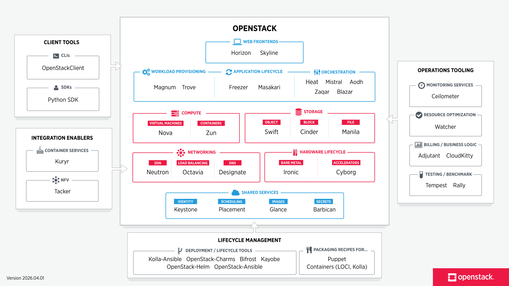

---
# Architecture
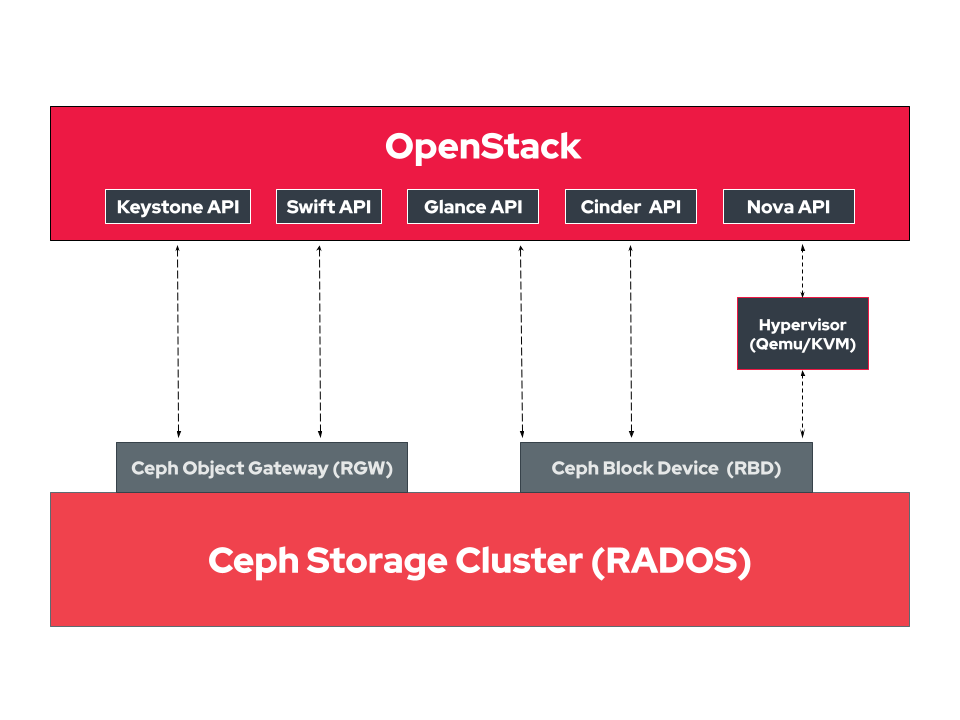

---
# Architecture
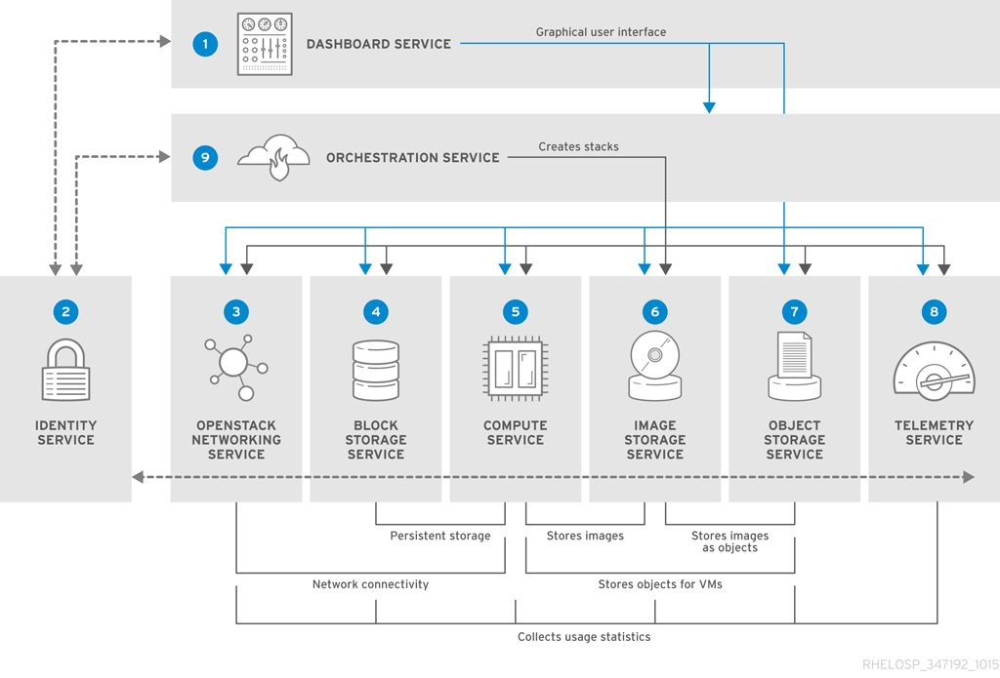

---
# Architecture
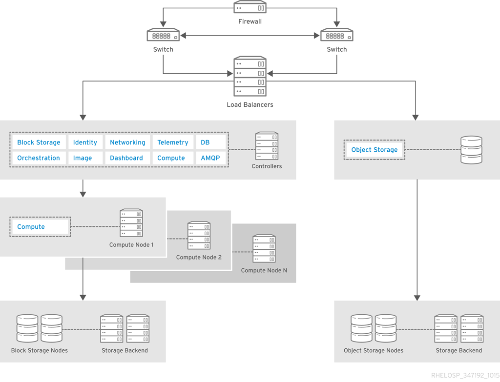

---
# Architecture
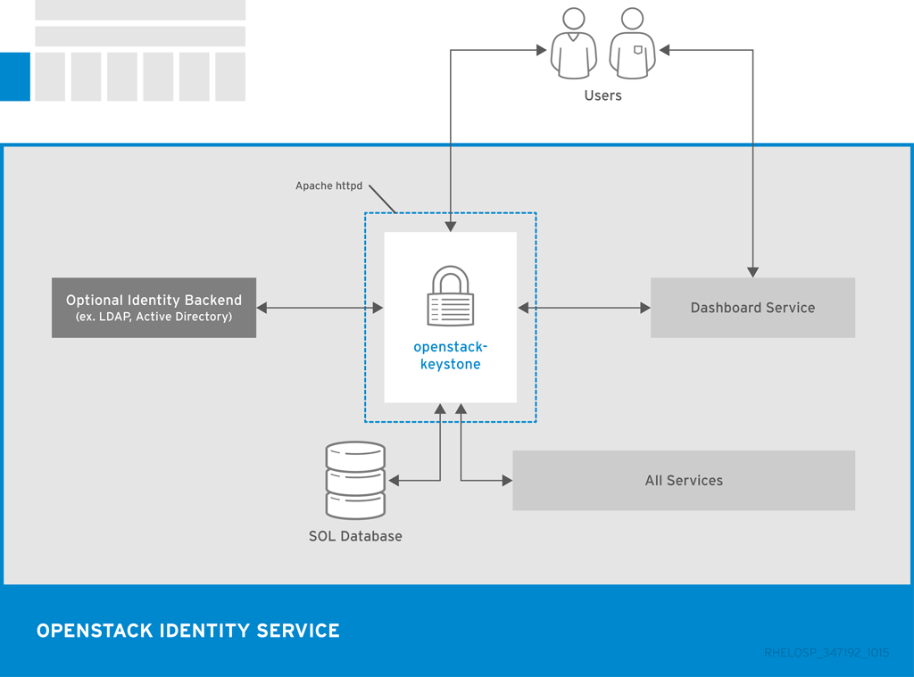

---
# Architecture
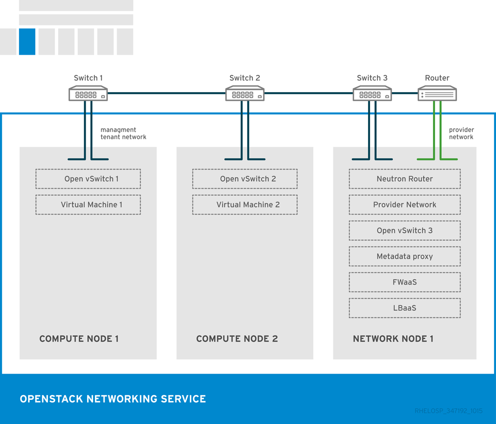

---
# Architecture
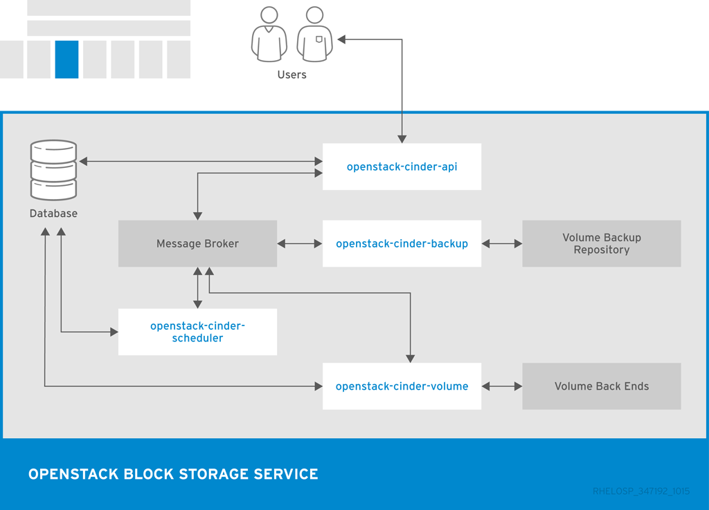

---
# Architecture
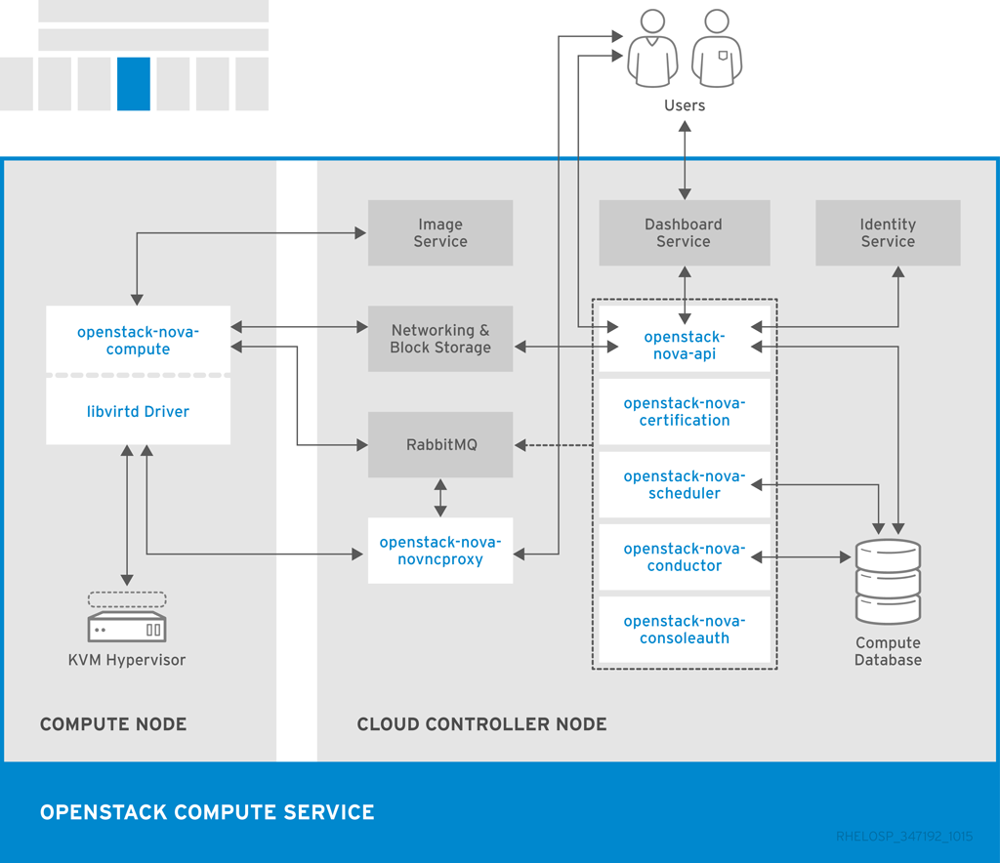

---
# Architecture
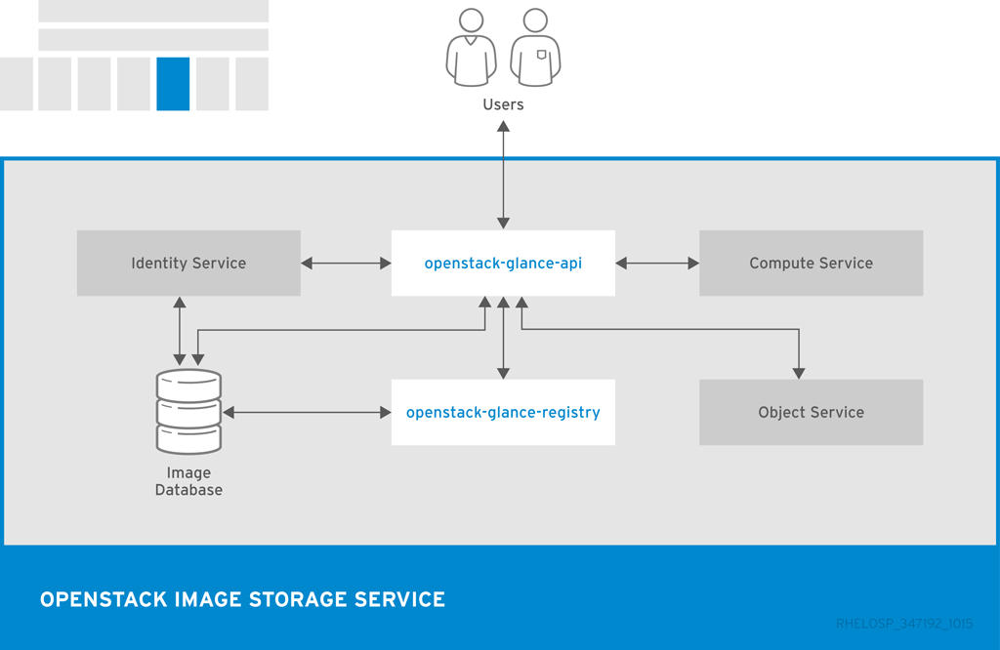

---
# Architecture
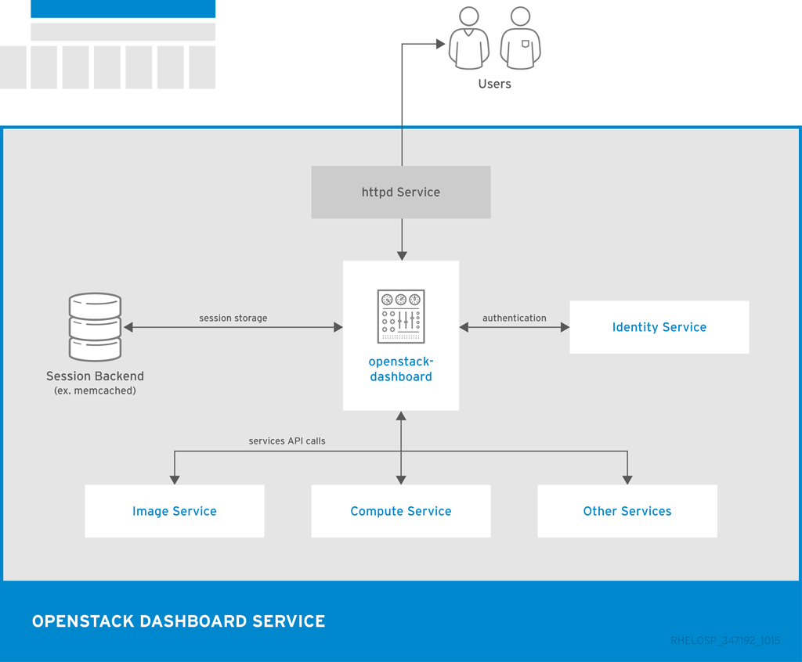


---
# Users


---
# Contributors


---
# Deployment Approaches

- openstack-ansible
- kolla-ansible
- OpenStack on OpenShift
- OpenStack-Helm
- OSISM
- YAOOK
...

---
# Deploy OpenStack
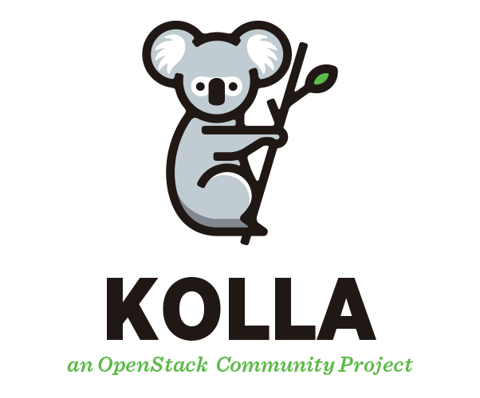

---
# OpenStack Network


---
# Environment Network


---
# Air-Gapped Environment
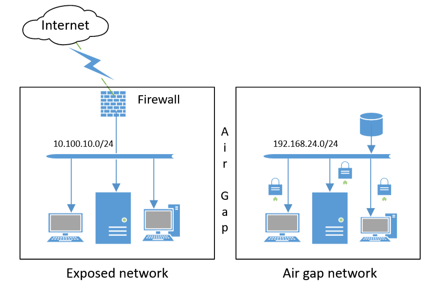

---
# Workshop Hardware and VMs
* Hardware: 60 vCPUs, 160 GB RAM, 1 TB disk
* Deployment VM
* Infra VMs: registry, proxy, dns, recorder
* OpenStack VMs: 3x Controller, 3x Network, 3(+)x Compute, 1xMonitoring, 1xTesting 

---
# Infrastructure
```plantuml alt="Infrastructure overview" renderer_hint="![bg right:40% 90%]"
skinparam backgroundColor transparent
!include <edgy/edgy>

cloud "Internet" as internet

$architectureFacet("Infrastructure", infrastructure) {
  $object("Registry\n(Harbor)", registry)
  $object("DNS\n(dnsmasq)", dns)
  $object("Proxy\n(squid)", proxy)
  $object("Recorder\n(ansible/ara)", recorder)
}

$productFacet("Environment", environment) {
  $organisationFacet("OpenStack", os)
  $object("Deployment", deploy)
}

$flowUp(dns, internet)
$flowUp(registry, internet)
$flowUp(proxy, internet)
$flowUp(os, registry)
$flowUp(os, dns)
$flowUp(deploy, proxy)
$flowUp(deploy, dns)
$flowUp(deploy, recorder)
```

---
# Deployment Node
* Python virtual envs
* kolla-ansible


---
# Deploy OpenStack


```bash
# Prepare Python virtual environment                                        📋
cd ~/openstack/

python3 -m venv $VENV_PATH

ln -s  $VENV_PATH ~/venv/openstack
source $VENV_PATH/bin/activate

# Install needed pip packages
pip install -U pip
pip install -r requirements.txt

# Install dependencies for kolla-ansible
kolla-ansible install-deps

# Install additional dependencies
gilt overlay

# Reload environment
source ~/.profile
```

---
# Deploy OpenStack

```bash
# Prepare ansible inventory                                                 📋

# Copy inventory file
cp ~/venv/openstack/share/kolla-ansible/ansible/inventory/multinode inventory/

# Patch inventory file and review inventory/lab/ directory afterwards
crudini --del inventory/multinode control
crudini --del inventory/multinode network
crudini --del inventory/multinode compute
crudini --del inventory/multinode monitoring
crudini --del inventory/multinode storage
crudini --del inventory/multinode loadbalancer:children

# Prepare passwords
cp ~/venv/openstack/share/kolla-ansible/etc_examples/kolla/passwords.yml \
  custom-config/lab/passwords.yml

kolla-genpwd -p custom-config/lab/passwords.yml
```

---
# Deploy OpenStack

```bash
# Overview of kolla-ansible commands                                        📋

kolla-ansible bootstrap-servers    -i inventory/lab
kolla-ansible octavia-certificates -i inventory/lab
kolla-ansible prechecks            -i inventory/lab
kolla-ansible pull                 -i inventory/lab
kolla-ansible deploy               -i inventory/lab  -vvvv
kolla-ansible post-deploy          -i inventory/lab
kolla-ansible check                -i inventory/lab
kolla-ansible destroy              -i inventory/lab <--yes-i-really-really-mean-it>
kolla-ansible mariadb_recovery     -i inventory/lab
kolla-ansible reconfigure          -i inventory/lab
kolla-ansible upgrade              -i inventory/lab
kolla-ansible stop                 -i inventory/lab
kolla-ansible deploy-containers    -i inventory/lab
kolla-ansible prune-images         -i inventory/lab
```

---
# Deploy OpenStack

```bash
# Prepare the kolla-ansible deployment                                      📋

kolla-ansible bootstrap-servers    -i inventory/lab
kolla-ansible octavia-certificates -i inventory/lab
kolla-ansible prechecks            -i inventory/lab

# ⚠️ NOTE: this will take time
kolla-ansible pull                 -i inventory/lab
```

---
# Deploy OpenStack

```bash
# Prepare the kolla-ansible deployment                                      📋

# ⚠️ NOTE: this will take time
kolla-ansible deploy               -i inventory/lab

# Post deployment steps
kolla-ansible post-deploy          -i inventory/lab
kolla-ansible check                -i inventory/lab
```

---
# Bootstrap a Test Environment

```bash
# Create first basic test resources                                         📋
KOLLA_CONFIG_PATH=~/openstack/custom-config/lab/    \
ENABLE_EXT_NET=1                                    \
EXT_NET_CIDR=10.30.0.0/24                           \
EXT_NET_GATEWAY=10.30.0.1                           \
EXT_NET_RANGE="start=10.30.0.240,end=10.30.0.245"   \
DEMO_NET_DNS=10.30.0.1                              \
~/venv/openstack/share/kolla-ansible/init-runonce
```


---
# Access

<style scoped>
table, thead, tbody, tr, th, td {
  background-color: transparent !important;
  border: none !important;
}
</style>
| | |
| :--- | :--- |
| Horizon     | [http://int.os.lab.nfgd.net](http://int.os.lab.nfgd.net/)      |
| Skyline     | [http://int.os.lab.nfgd.net:9999](http://int.os.lab.nfgd.net/) |
| CLI         | Command Line Interface                  |


Check the following files to use with CLI:
- custom-config/lab/admin-openrc.sh
- custom-config/lab/clouds.yaml

---
# Operations


---
# Service Overview

```bash
# Review the OpenStack environment                                          📋
openstack service  list
openstack endpoint list
openstack catalog  list

openstack compute       service list
openstack volume        service list 
openstack network       agent   list
openstack orchestration service list
```

---
# Replace a Network Node

```bash
# 🔍 Review data stored on the node. Is there anything to back up?          📋
docker volume ls
du -lhs /var/lib/docker/volumes/*

# 💥 Break the network03 node
apt remove  docker*  -y
rm -rf  /etc/kolla /var/log/kolla  \
        /etc/systemd/system/kolla* \
        /etc/systemd/system/multi-user.target.wants/kolla-* \
        /etc/docker/daemon.json
umount /var/lib/docker;  wipefs /dev/sdb -a; mkfs.ext4 /dev/sdb
reboot

# 🚚 Redeploy OpenStack services on network03 from the deployment node
kolla-ansible bootstrap-servers -i inventory/lab --limit ~network03
kolla-ansible prechecks         -i inventory/lab --limit ~network03
kolla-ansible pull              -i inventory/lab --limit ~network03
kolla-ansible reconfigure       -i inventory/lab --limit ~network03
```
---
# Replace a Controller Node

```bash
# 🔍 Review data stored on the node. Is there anything to back up?          📋
docker volume ls
du -lhs /var/lib/docker/volumes/*

# 💥 Break the controller03 node
systemctl stop kolla-* docker.service docker.socket
apt remove  docker*  -y
rm -rf  /etc/kolla /var/log/kolla  \
        /etc/systemd/system/kolla* \
        /etc/systemd/system/multi-user.target.wants/kolla-* \
        /etc/docker/daemon.json
umount /var/lib/docker;  wipefs /dev/sdb -a; mkfs.ext4 /dev/sdb
reboot

# 🚚 Redeploy OpenStack services on controller03 from the deployment node
kolla-ansible bootstrap-servers -i inventory/lab --limit ~controller03
kolla-ansible prechecks         -i inventory/lab --limit ~controller03
kolla-ansible pull              -i inventory/lab --limit ~controller03

# ☕ this will take a while
kolla-ansible reconfigure       -i inventory/lab --limit ~controller03 --skip-tags keystone

# ⚠️ we have to reconfigure keystone across all controller nodes ⚠️
kolla-ansible reconfigure       -i inventory/lab                       --tags      keystone
```
---
# Clean OVN DBs after rebuilding a controller node

```bash
# on a healthy controller node                                              📋

# SB DB: get the stale id (of the node before rebuild)
docker exec ovn_sb_db ovs-appctl -t /var/run/ovn/ovnsb_db.ctl cluster/status OVN_Southbound | awk '/match_index=0 last msg/{print $1}'
# kick it out
docker exec ovn_sb_db ovs-appctl -t /var/run/ovn/ovnsb_db.ctl cluster/kick OVN_Southbound <id>

# NB DB: get the stale id
docker exec ovn_nb_db ovs-appctl -t /var/run/ovn/ovnnb_db.ctl cluster/status OVN_Northbound | awk '/match_index=0 last msg/{print $1}'
docker exec ovn_nb_db ovs-appctl -t /var/run/ovn/ovnnb_db.ctl cluster/kick OVN_Northbound <id>
```

---
# Replace a Compute Node

```bash
# 🚧 Drain the OpenStack compute host
openstack server list --all       --host    <COMPUTE_NAME>
openstack compute service set     --disable <COMPUTE_NAME> nova-compute
for vm in $(openstack server list --host    <COMPUTE_NAME> --all-projects -c ID -f value);
do
  echo "Evacuating VM: $vm"
  openstack server migrate --live $vm
done
openstack server list --all       --host    <COMPUTE_NAME>

# 🔍 Review data stored on the node. Is there anything to back up?          📋
docker volume ls
du -lhs /var/lib/docker/volumes/*
docker exec -ti nova_libvirt virsh list  --all

# 💥 Break the node
# On the node
systemctl stop kolla-* docker.service docker.socket
apt remove  docker*  -y
rm -rf  /etc/kolla /var/log/kolla  \
        /etc/systemd/system/kolla* \
        /etc/systemd/system/multi-user.target.wants/kolla-* \
        /etc/docker/daemon.json
cp -pr  /var/lib/docker/volumes ~/
umount  /var/lib/docker;  wipefs /dev/sdb -a; mkfs.ext4 /dev/sdb
reboot

# 🚚 Redeploy OpenStack services on compute03 from the deployment node
kolla-ansible bootstrap-servers -i inventory/lab --limit ~<COMPUTE_NAME>
kolla-ansible prechecks         -i inventory/lab --limit ~<COMPUTE_NAME>
kolla-ansible pull              -i inventory/lab --limit ~<COMPUTE_NAME>
kolla-ansible reconfigure       -i inventory/lab --limit ~<COMPUTE_NAME> --skip-tags ovn
kolla-ansible reconfigure       -i inventory/lab --tags  ovn

# 🩺 check the compute host
docker exec -ti nova_libvirt virsh list  --all
docker exec ovn_sb_db ovn-sbctl show

# 🔌 Live-migrate a VM onto the compute host
openstack server  migrate --live --host <COMPUTE_NAME> <SERVER_ID>
```

---
# Debugging

```bash
# 🩺 Check                                                                  📋
openstack compute service list

# 🔍 Take a look at logs on the compute host
tail -f /var/log/kolla/nova/nova-compute.log
tail -f /var/log/kolla/neutron/neutron-*.log
tail -f /var/log/kolla/libvirt/libvirtd.log

# 🔍 Compare files on nova_compute volume and in the backup
ls -lh ~/volumes/nova_compute/_data/ /var/lib/docker/volumes/nova_compute/_data/

# ⚙️ Repair if needed
cp ~/volumes/nova_compute/_data/compute_id  /var/lib/docker/volumes/nova_compute/_data/

# 🩺 Check the status again and test
openstack compute service list
openstack compute service set --enable <COMPUTE_NAME> nova-compute
openstack server migrate --live --host <COMPUTE_NAME> <SERVER_ID>
openstack server list    --all  --long
```
---
# Scale-out

* How to scale out controllers?
* How to scale out network nodes?
* How to scale out compute nodes?

---
# Add a New Compute Host

```bash
# 📝 Modify inventory, put the new compute host into the hypervisor section 📋
vim inventory/lab/20_openstack

# 🩺 Check the new host

# 🚚 Deploy OpenStack services on the new compute host
kolla-ansible bootstrap-servers -i inventory/lab
kolla-ansible prechecks         -i inventory/lab --limit ~<COMPUTE_NAME>
kolla-ansible pull              -i inventory/lab --limit ~<COMPUTE_NAME>
kolla-ansible deploy            -i inventory/lab --limit ~<COMPUTE_NAME> --skip-tags ovn
kolla-ansible deploy            -i inventory/lab --tags  ovn

# 🩺 check the compute host
docker exec -ti nova_libvirt virsh list  --all
docker exec ovn_sb_db ovn-sbctl show

# 🔌 Live-migrate a VM onto the compute host
openstack compute service list
openstack server  migrate --live --host <COMPUTE_NAME> <SERVER_ID>
```

---
# Remove a Compute Host


```bash
# 🚧 disable the compute host                                               📋
openstack compute service set --disable --disable-reason "decommission" <COMPUTE_NAME> nova-compute

# 🚚 live-mgrate instances from the compute host
openstack server list --all-projects --host <COMPUTE_NAME> --status ACTIVE -f value -c ID \
  | xargs --max-procs 3 -I{} sh -c 'echo {}; openstack server migrate --live-migration {};'

# 🚚 migrade stopped instances, cold migration, then confirm each one
openstack server list --all-projects --host computeNN --status SHUTOFF -f value -c ID \
  | xargs --max-procs 3 -I{} sh -c 'echo {}; openstack server migrate {};'

# then confirm each
openstack server resize confirm <id>

# 🩺 verify no servers remains on the compute host
openstack server list --all --long --host <COMPUTE_NAME>

# ❌ stop services on the compute host
systemctl stop kolla-*

# ❌ nova service
openstack compute service list --host <COMPUTE_NAME>
openstack compute service delete <nova-compute-service-id>

# ❌ placement: allocations must be empty, then delete the provider
openstack resource provider list --name <COMPUTE_NAME>
openstack resource provider usage show  <rp-uuid>
openstack resource provider delete      <rp-uuid>

# ❌ neutron agents: list and delete each
openstack network agent list --host <COMPUTE_NAME>
openstack network agent delete <agent-id>

# ❌ on a controller delete OVN chassis
docker exec ovn_sb_db ovn-sbctl show
docker exec ovn_sb_db ovn-sbctl chassis-del <COMPUTE_NAME>

# 💥 destroy all openstack services on the compute node
kolla-ansible destroy -i inventory/lab --limit ~<COMPUTE_NAME> <--yes-i-really-really-mean-it>
```

---
# Reboot an OpenStack Host

* How to reboot controllers?
* How to reboot network nodes?
* How to reboot compute nodes?

---
# Reboot a Controller

```bash
# 🩺 Check MySQL status
MYSQL_PASS=$(cat /etc/kolla/mariadb/galera.cnf  | grep wsrep_sst_auth | awk -F: '{print $NF}')
docker exec mariadb mysql -uroot -p$MYSQL_PASS -e "SHOW STATUS LIKE 'wsrep_%'"
docker exec mariadb mysql -uroot -p$MYSQL_PASS -e "SHOW PROCESSLIST"

# 🩺 Check teh rabbitmq status
docker exec rabbitmq rabbitmqctl cluster_status

# 🩺 Check the  OVN status
docker exec ovn_nb_db ovs-appctl -t /var/run/ovn/ovnnb_db.ctl cluster/status OVN_Northbound
docker exec ovn_sb_db ovs-appctl -t /var/run/ovn/ovnsb_db.ctl cluster/status OVN_Southbound


# 🚧 Prepare for reboot
docker    exec rabbitmq rabbitmq-upgrade drain

systemctl stop kolla-rabbitmq-container.service
systemctl stop kolla-mariadb-container.service

# 🔁 Now the host can be rebootet
reboot

# After reboot
docker exec rabbitmq rabbitmq-queues rebalance quorum

# 🩺 Check the rabbitmq status
docker exec rabbitmq rabbitmqctl cluster_status

# 🩺 Check the mysql status

MYSQL_PASS=$(cat /etc/kolla/mariadb/galera.cnf  | grep wsrep_sst_auth | awk -F: '{print $NF}')
docker exec mariadb mysql -uroot -p$MYSQL_PASS -e "SHOW STATUS LIKE 'wsrep_%'"
docker exec mariadb mysql -uroot -p$MYSQL_PASS -e "SHOW PROCESSLIST"

# 🩺 Check the  OVN status
docker exec ovn_nb_db ovs-appctl -t /var/run/ovn/ovnnb_db.ctl cluster/status OVN_Northbound
docker exec ovn_sb_db ovs-appctl -t /var/run/ovn/ovnsb_db.ctl cluster/status OVN_Southbound
```


---
# Debugging RabbitMQ


```bash
# Some commands to debug RabbitMQ errors                                    📋
rabbitmqctl status
rabbitmqctl cluster_status

rabbitmq-plugins list
rabbitmq-plugins disable <PLUGIN>
rabbitmq-plugins enable  <PLUGIN>

rabbitmqctl list_queues name,messages,messages_ready,messages_unacknowledged,leader
rabbitmqctl list_bindings 

rabbitmqctl purge_queue   <QUEUE_NAME>
rabbitmqctl delete_queue  <QUEUE_NAME>

# Repair rabbitmq with kolla-ansible
kolla-ansible rabbitmq-reset-state -i inventory/lab/
```

---
# Upgrade


---
# SLURP Model
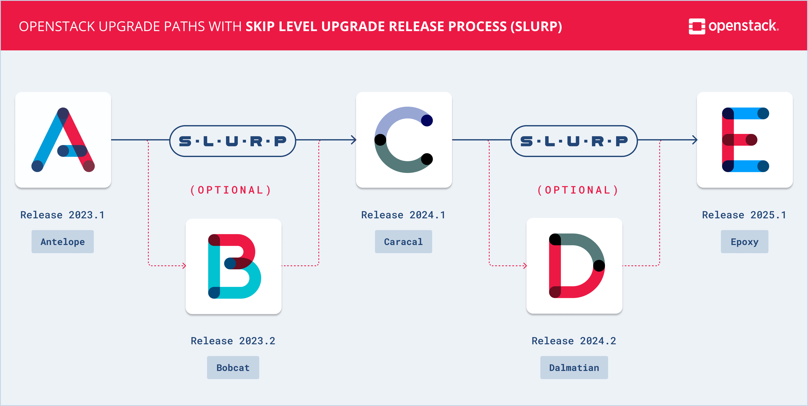

---
# Roll out the Next Release

```bash
# 📝 Update kolla-ansible                                                   📋
CUR_KA_VER=$(pip list | grep kolla | awk '{print $NF}' | awk -F . '{print $1}')

echo $VIRTUAL_ENV
deactivate
python3  -m venv ~/venv/kolla-ansible-$((CUR_KA_VER+1)) 
source  ~/venv/kolla-ansible-$((CUR_KA_VER+1))/bin/activate

pip install -U pip
pip install -r requirements.txt
pip install -U "kolla-ansible<$((CUR_KA_VER + 2)).0"
kolla-ansible install-deps

# switch the active virtual env
rm -rf ~/venv/openstack
ln -s $VIRTUAL_ENV ~/venv/openstack

# relogin and check $VIRTUAL_ENV
echo $VIRTUAL_ENV
which kolla-ansible
```

---
# Roll out the Next Release
## **Inventory**

```bash
# Update inventory                                                          📋
mv inventory/multinode inventory/multinode.old
cp $VIRTUAL_ENV/share/kolla-ansible/ansible/inventory/multinode inventory/
crudini --del inventory/multinode control
crudini --del inventory/multinode network
crudini --del inventory/multinode compute
crudini --del inventory/multinode monitoring
crudini --del inventory/multinode storage
crudini --del inventory/multinode loadbalancer:children

# Review the differences
diff -y --suppress-common-lines  inventory/multinode  inventory/multinode.old
```

---
# Roll out the Next Release
## **Passwords**

```bash
# Update passwords                                                          📋
mv custom-config/lab/passwords.yml custom-config/lab/passwords.yml.old
cp $VIRTUAL_ENV/share/kolla-ansible/etc_examples/kolla/passwords.yml \
    custom-config/lab/passwords.yml
kolla-genpwd -p custom-config/lab/passwords.yml
kolla-mergepwd \
  --old   custom-config/lab/passwords.yml.old \
  --new   custom-config/lab/passwords.yml     \
  --final custom-config/lab/passwords.yml

# Review the differences
diff -y --suppress-common-lines  custom-config/lab/passwords.yml custom-config/lab/passwords.yml.old
```

---
# Roll out the Next Release
## **Go**

```bash
# 💾 Create all backups you can                                             📋
# config
ansible  all -b -m ansible.builtin.shell -a \
  "mkdir -p ~/backup; cp  -r /etc/kolla ~/backup/$(date +%y%m%d%H%M%S)_kolla" 

# mysql: see Backup and Recovery

# 🗂️ Force to collect facts
rm -rf   $VIRTUAL_ENV/ansible-facts/*
kolla-ansible gather-facts -i inventory/lab

# 🩺 Check
kolla-ansible prechecks    -i inventory/lab

# 📥 Pull images
kolla-ansible pull         -i inventory/lab

# 🚚 Upgrade
kolla-ansible upgrade      -i inventory/lab
```
---
# High Availability

* Keepalived & HAProxy (controllers)
* Stateless API Services
* MariaDB Galera Cluster as State Store
* Message Broker (RabbitMQ)
* Multiple nodes of each type

---
# Debugging Common

```bash
# Some useful commands for debugging                                        📋

# On each node
docker ps  | grep unhealthy
df -Ph

# On controller node
tail -f /var/log/kolla/mariadb/mariadb.log
tail -f /var/log/kolla/rabbitmq/rabbit*.log

# On deployment node
openstack compute service list
openstack volume  service list
openstack network agent   list

# Check HA IP on controller nodes
ip -br a

# Search for error messages connected with a resource
grep -r [RESOURCE_ID] /var/log/kolla/[SERVICE]
```

---
# Backup and Recovery

* MySQL   Backup
* Config  Backup (can be restored by kolla)
* Volumes Backup (can be ⚠️ partially restored)
* Message Queues (are recreated if lost)

---
# Database Backup and Recovery

```bash
# Create a new backup                                                       📋
kolla-ansible mariadb-backup -i inventory/lab

# Check on the controller
ls -lh /var/lib/docker/volumes/mariadb_backup/_data/

# To restore
gunzip -c <BACKUP_FILE> | docker exec -i mariadb mysql -u root -p

# If the DB cluster cannot create a quorum
kolla-ansible mariadb-recovery -i inventory/lab
```
---
# Monitoring

<style scoped>
table, thead, tbody, tr, th, td {
  background-color: transparent !important;
  border: none !important;
}
</style>
* Ceilometer / Gnocchi / Aodh (for Billing)
* Prometheus / Alertmanager / Grafana

| | |
| :--- | :--- |
| Grafana      | [http://int.os.lab.nfgd.net:3000](http://int.os.lab.nfgd.net:3000) |
| Prometheus   | [http://int.os.lab.nfgd.net:9091](http://int.os.lab.nfgd.net:9091) |
| Alertmanager | [http://int.os.lab.nfgd.net:9093](http://int.os.lab.nfgd.net:9091) |

---
# Expand / Deploy a New Service
## **Central Logging**

```bash
# 🔌 Enable central logging                                                 📋
cat custom-config/lab/globals.d/logging.yml
sed -e 's/enable_central_logging:.*/enable_central_logging: "yes"/' \
    -i custom-config/lab/globals.d/logging.yml
cat custom-config/lab/globals.d/logging.yml

# 🚚 Deploy the new service
kolla-ansible pull          -i inventory/lab --tags opensearch
kolla-ansible deploy        -i inventory/lab --tags opensearch
kolla-ansible reconfigure   -i inventory/lab --tags common
```

Visit: 
- http://int.os.lab.nfgd.net:5601
- visualize, create an index pattern
- discover

---
# Expand / Deploy a New Service
## **Rating Service**

```bash
# 🔌 Enable CloudKitty                                                      📋
cat custom-config/lab/globals.d/cloudkitty.yml
sed -e 's/enable_cloudkitty:.*/enable_cloudkitty: "yes"/' \
    -i custom-config/lab/globals.d/cloudkitty.yml
cat custom-config/lab/globals.d/cloudkitty.yml

# 🚚 Deploy the new service
kolla-ansible pull   -i inventory/lab --tags influxdb,cloudkitty
kolla-ansible deploy -i inventory/lab --tags loadbalancer,influxdb,cloudkitty,horizon

# 🩺 check
openstack catalog list
```

---
# Rating Service

## **Configuration**
```bash
# 🔧 Configure CloudKitty                                                   📋
pip3 install python-cloudkittyclient

openstack rating module enable hashmap
openstack rating module set priority hashmap 100
openstack rating module list

openstack rating hashmap service create openstack_nova_server_status
openstack rating hashmap service list

openstack rating hashmap mapping create -s <service_id> -t flat 0.02

openstack rating hashmap mapping list -s <service-id>
openstack rating summary get
openstack rating dataframes get

```

---
# Using OpenStack


---
# Images

```bash
# Image sources                                                             📋
ALMA_IMG_NAME=$(
  curl -sS https://repo.almalinux.org/almalinux/10/cloud/x86_64/images/CHECKSUM \
    | grep GenericCloud-10[.] | sort | tail -n1 | awk '{print $NF}')
ALMA_VERSION=$(echo "$ALMA_IMG_NAME" | cut -d- -f4)
ALMA_LINK=https://repo.almalinux.org/almalinux/10/cloud/x86_64/images/$ALMA_IMG_NAME

ROCKY_IMG_NAME=$(
  curl -sS https://dl.rockylinux.org/pub/rocky/10/images/x86_64/CHECKSUM   \
    | grep SHA256 | awk '{print $2}'  | grep GenericCloud-LVM- \
    | sed -e "s/[()]//g" | sort | tail -n1
)
ROCKY_VERSION=$(echo "$ROCKY_IMG_NAME" | cut -d- -f5)
ROCKY_LINK=https://dl.rockylinux.org/pub/rocky/10/images/x86_64/$ROCKY_IMG_NAME

UBUNTU_VERSION="24.04"
UBUNTU_IMG_NAME=noble-server-cloudimg-amd64.img
UBUNTU_LINK="https://cloud-images.ubuntu.com/noble/current/$UBUNTU_IMG_NAME"

DEBIAN_VERSION="13"
DEBIAN_IMG_NAME=debian-13-generic-amd64.qcow2
DEBIAN_LINK="https://cloud.debian.org/images/cloud/trixie/latest/$DEBIAN_IMG_NAME"
```

---
# Images

```bash
# Download images                                                           📋
mkdir -p  ~/cloud-images/

for i in  alma~$ALMA_VERSION~$ALMA_LINK       \
          rocky~$ROCKY_VERSION~$ROCKY_LINK    \
          ubuntu~$UBUNTU_VERSION~$UBUNTU_LINK \
          debian~$DEBIAN_VERSION~$DEBIAN_LINK
do
  IFS="~" read -r -a fields <<< $i
  name=${fields[0]}
  version=${fields[1]}
  link=${fields[2]}
  filepath=~/cloud-images/$(basename $link)

  echo "Downloading $name-$version image"
  curl --output-dir ~/cloud-images -L -O $link

  echo "Uploading $name-$version image into OpenStack"
  openstack image create "$name-$version"       \
      --file             "$filepath"            \
      --disk-format       qcow2                 \
      --container-format  bare                  \
      --property          os_distro="$name"     \
      --property          os_version="$version" \
      --public
done

# Check
openstack image list --long
```

---
# Authentication / Authorization

```bash
# Set permissions                                                           📋
PRJ_NAME=workshop
USR_NAME=workshop
USR_PASS=workshop

# Create project
openstack project create                             $PRJ_NAME
openstack quota set --instances 32 --cores 64        $PRJ_NAME

# Create user
openstack user create --password $USR_PASS --project $PRJ_NAME $USR_NAME

# Create permissions for the user
openstack role add    --user $USR_NAME     --project $PRJ_NAME member

# Check
openstack role assignment list --name
openstack quota show $PRJ_NAME
```

---
# How to authenticate with CLI

```bash
# Prepare an openrc file to be used with the OpenStack CLI                  📋
cp  custom-config/lab/admin-openrc.sh  custom-config/lab/workshop-openrc.sh

sed  -e "s/OS_PROJECT_NAME=.*/OS_PROJECT_NAME=$PRJ_NAME/" -i custom-config/lab/workshop-openrc.sh
sed  -e "s/OS_TENANT_NAME=.*/OS_TENANT_NAME=$PRJ_NAME/"   -i custom-config/lab/workshop-openrc.sh
sed  -e "s/OS_PASSWORD=.*/OS_PASSWORD=$USR_PASS/"         -i custom-config/lab/workshop-openrc.sh
sed  -e "s/OS_USERNAME=.*/OS_USERNAME=$USR_NAME/"         -i custom-config/lab/workshop-openrc.sh

# Review
cat    custom-config/lab/workshop-openrc.sh
# Activate
source custom-config/lab/workshop-openrc.sh

openstack network list
openstack router  list
openstack server  list
```
---
# Networking
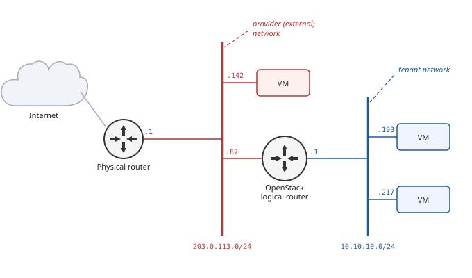
* Networks:
  * flat
  * vlan
  * vxlan
  * geneve
* Routers
* Floating IPs
* Load Balancers

---
# Networking
## **External Network**


```bash
# Create external network (VLAN backed)                                     📋
# as admin
EXT_NET_VLAN=3010
EXT_NET_NAME="shared${EXT_NET_VLAN}"
EXT_NET_CIDR='10.30.10.0/24'
EXT_NET_RANGE='start=10.30.10.192,end=10.30.10.254'
EXT_NET_GATEWAY='10.30.10.1'

openstack network create       ${EXT_NET_NAME}  \
   --provider-physical-network physnet3         \
   --provider-network-type     vlan             \
   --provider-segment          ${EXT_NET_VLAN}  \
   --external

openstack subnet create  ${EXT_NET_NAME}-subnet \
    --allocation-pool    ${EXT_NET_RANGE}       \
    --network            ${EXT_NET_NAME}        \
    --subnet-range       ${EXT_NET_CIDR}        \
    --gateway            ${EXT_NET_GATEWAY}     \
    --no-dhcp
```

---
# Networking
## **Project Network**

```bash
# Create project network                                                    📋
# as workshop user in workshop project

# Activate
source custom-config/lab/workshop-openrc.sh

openstack network create workshop-net

openstack subnet create workshop-subnet \
  --subnet-range 10.10.10.0/24          \
  --network workshop-net                \
  --gateway 10.10.10.1

openstack router create workshop-router
openstack router add subnet workshop-router workshop-subnet
openstack router set --external-gateway shared3010 workshop-router
```

---
# Networking
## **Virtual Machines**

```bash
# as workshop user in workshop project

IMAGE_NAME=ubuntu-24.04
# IMAGE_NAME=alma-10.1
# IMAGE_NAME=rocky-10.1
# IMAGE_NAME=debian-13

openstack keypair create --public-key ~/.ssh/id_ecdsa.pub mykey

openstack server create          \
  --image    ${IMAGE_NAME}       \
  --flavor   m1.small            \
  --key-name mykey               \
  --nic      net-id=workshop-net \
  vm0

openstack server create                  \
  --image            ${IMAGE_NAME}       \
  --flavor           m1.small            \
  --key-name         mykey               \
  --nic              net-id=workshop-net \
  --boot-from-volume 10                  \
  vm1
```


---
# Networking
## **How to access?**
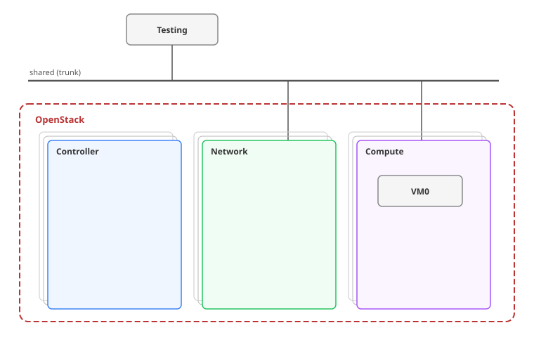

```bash
# Create a config for a VLAN interface                                      📋
# on the testing node as root
myid=$(cat /etc/env.json  | jq .id)

cat > /etc/netplan/80-vlan.yaml <<EOF
network:
  version: 2
  vlans:
    xtrn0.3010:
      addresses:
      - "10.30.10.${myid}/24"
      dhcp4: false
      dhcp6: false
      id: 3010
      link: eth3
      link-local: []
EOF

chmod 600 /etc/netplan/80-vlan.yaml

netplan apply
```

---
# Networking
## **How to access?**

```bash
# Copy the ssh key from deployment to testing node                          📋
scp ~/.ssh/id_ecdsa* testing.mgmt.lab.nfgd.net:~/.ssh/

# within workshop project
# Assign floating IPs to VMs
openstack floating ip  create shared3010
FIP_VM0=$(
  openstack floating ip  create shared3010 -f value -c floating_ip_address
)
openstack server add floating ip vm0 $FIP_VM0

FIP_VM1=$(
  openstack floating ip  create shared3010 -f value -c floating_ip_address
)
openstack server add floating ip vm1 $FIP_VM1

# Review assigned IPs
openstack server list

# Allow access to vm0
openstack security group create allow-simple-access
openstack security group rule create allow-simple-access \
  --protocol tcp \
  --dst-port 22 \
  --remote-ip 0.0.0.0/0 \
  --ingress
openstack security group rule create allow-simple-access   \
  --protocol icmp \
  --remote-ip 0.0.0.0/0 \
  --ingress
openstack server add security group vm0 allow-simple-access
openstack server add security group vm1 allow-simple-access

# You should be able to connect to VMs from the testing node
ping -c 3 <IP>
ssh -i ~/.ssh/id_ecdsa ubuntu@<IP>
```


---
# Networking
## **Debugging**


[//]: # (# For OVS Deployments:)
[//]: # (# On network nodes check if there are network namespaces created for the router)
[//]: # (# qrouter-<ROUTER_ID>)
[//]: # (# snat-<ROUTER_ID>)
[//]: # (# fip-<FLOATING_IP_NETWORK_ID>)
[//]: # (ip netns)
[//]: # (# Check if IP addresses are assigned)
[//]: # (ip netns exec <NETWORK_NAMESPACE_ID> ip a)
[//]: # ()
[//]: # (# On compute nodes check if there are network namespaces created for the router)
[//]: # (ip netns)

```bash
# 🩺 Check VMs and IPs assigned to them                                     📋
openstack server list --long

# 🩺 Check the state of network services
openstack network agent list

# 🩺 Check the router has connectivity to the external network
# 🩺 Check the router has IPs from the tenant network assigned
openstack router show workshop-router

# 🩺 Find the gateway port, check the node the port is bound to
openstack port list --router workshop-router --long  | grep gateway
openstack port show <PORT_ID>

# 🩺 on a controller
docker exec ovn_nb_db ovn-nbctl lr-list
docker exec ovn_nb_db ovn-nbctl lrp-list <LRP_ID>
docker exec ovn_sb_db ovn-sbctl show | grep <PORT_ID> -B 10
docker exec ovn_nb_db ovn-nbctl lrp-get-gateway-chassis lrp-<PORT_ID>
```

[//]: # (---)
[//]: # (# Network Namespaces)
[//]: # (![bg right:50% 90%]\(assets/pics/openstack/network-namespaces-funtoo.png\))

---
# User Config with Cloud-Init

```bash
# Create user-data.yaml                                                     📋
cat > user-data.yaml <<EOF
#cloud-config
runcmd:
  - mkdir -p /var/lib/data/test
  - echo "<h1>Hello from runcmd</h1>" > /var/lib/data/test/hello.html
fs_setup:
  - device:     /dev/vdb
    filesystem: ext4
    overwrite:  true
mounts:
  - [ /dev/vdb, /var/lib/data, "ext4", "defaults,nofail", "0", "2" ]
write_files:
  - path:        /var/lib/data/index.html
    owner:       root:root
    permissions: '0644'
    content: |
      <h1>Hello from write_files</h1>
EOF
```

---
# User Config with Cloud-Init

```bash
# Create a new VM with an additional volume                                 📋
root_uuid=$(
  openstack volume create \
    --image "${IMAGE_NAME}" --size 10 -c Id -f value vm2-root
)
data_uuid=$(openstack volume create --size 10 -c Id -f value vm2-data )

openstack volume list

openstack server create \
  --flavor m1.small \
  --key-name mykey \
  --nic net-id=workshop-net \
  --block-device uuid=$root_uuid,source_type=volume,destination_type=volume,boot_index=0 \
  --block-device uuid=$data_uuid,source_type=volume,destination_type=volume,boot_index=-1 \
  --user-data ./user-data.yaml \
  vm2


# Inspect
openstack server show vm2 -fyaml
openstack volume list

# Create a new floating IP and attach it to the server
vm2_ip=$(openstack floating ip create -f value -c floating_ip_address shared3010)
openstack server add floating ip vm2 $vm2_ip
```
---
# User Config
## **Inspect the Created VM**

```bash
# Log in from testing node                                                  📋
ssh -i ~/.ssh/id_ecdsa ubuntu@<FLOATING_IP>

# add the  allow-simple-access security group to the server, try again
openstack server add security group  vm2 allow-simple-access

ssh -i ~/.ssh/id_ecdsa ubuntu@<FLOATING_IP>

# within the vm2
cat /etc/fstab
mount | grep vdb

cat /var/lib/data/index.html
cat /var/lib/data/test/hello.html

cloud-init status
cloud-init status --long
```

---
# Debugging

```bash
# 🩺 Inspect the instance                                                   📋
openstack server show vm2

# Inspect VM with libvirt on the compute host
docker exec -ti nova_libvirt virsh list
docker exec -ti nova_libvirt virsh dumpxml    <INSTANCE_NAME>
docker exec -ti nova_libvirt virsh console    <INSTANCE_NAME> # ctrl+5 to exit
docker exec -ti nova_libvirt virsh domblklist <INSTANCE_NAME>
docker exec -ti nova_libvirt virsh domiflist  <INSTANCE_NAME>

# 🩺 Inspect volumes backed by Ceph on the compute host
docker exec -ti nova_compute ls /etc/ceph/
docker exec -ti nova_compute ceph -s
docker exec -ti nova_compute ceph --id cinder -s
docker exec -ti nova_compute ceph --id cinder osd pool ls
docker exec -ti nova_compute rbd  --id cinder ls images
docker exec -ti nova_compute rbd  --id cinder ls vms
docker exec -ti nova_compute rbd  --id cinder ls volumes

# 🩺 Inspect network interfaces on the compute host
docker exec -ti openvswitch_vswitchd ovs-vsctl show
```

---
# Block Devices

```bash
# How many VMs are running? How many volumes should we see?                 📋
openstack volume list

# Create a new volume and attach it
openstack volume create  --size 1 vm1-data
openstack server add volume   vm1 vm1-data

openstack volume attachment list --server-id $(
  openstack server show vm1 -c Id -f value
)


# Inspect it within the VM from the testing node
lsblk

# Create some data on it
mkfs.ext4 /dev/vdb
mount /dev/vdb /mnt
echo "$(date) Hello from vm1" > /mnt/test.txt

# Take a snapshot on the deployment node, hint: --os-volume-api-version 3.66
openstack volume snapshot create --volume vm1-data vm1-data-snap1 [--force]
openstack volume snapshot list

# Change the data
echo "Let us add a new line into the file after the snapshot was created"  >> /mnt/test.txt
cat  /mnt/test.txt
```
---
# Block Devices
## **Revert a Volume**

```bash
# Restore from the snapshot                                                 📋

openstack server list;  openstack volume list;
openstack volume snapshot list --volume vm1-data

openstack server remove volume vm1 vm1-data
openstack volume revert            vm1-data-snap1
openstack server add    volume vm1 vm1-data

# now you can inspect the device within vm1 again
```

---
# Block Devices
## **More Operations**

```bash
# Create a volume from an image                                             📋
openstack volume create --image cirros --size 1 vol-from-cirros-image

# Create a volume from a snapshot, hint: --os-volume-api-version 3.66
openstack volume snapshot create --volume vm2-root vm2-root-snap1 [--force]
openstack volume create --snapshot vm2-root-snap1 ubuntu-24.04-from-vm2

# Create an image from a volume
openstack image create  --volume ubuntu-24.04-from-vm2 ubuntu-24.04-custom 
openstack image list 
```

---
# Resource Segregation

- Projects
- Host Aggregates
- Volume Backends
- Network Agents
- Availability Zones

---
# Availability Zones

is a human-readable label that represents a **physically isolated slice of data center infrastructure**. It is the primary tool used to group hardware into separate **fault domains** so that a single physical failure does not take down an entire cloud application.

---
# Availability Zones

* Power Distribution Unit
* Data Center (Room)
* Cooling Domain
* Top-of-Rack (ToR) Switch Domain
* Storage Backend

---
# Availability Zones

```bash
openstack aggregate create --zone az0 lab-az0
openstack aggregate create --zone az1 lab-az1

openstack aggregate add host lab-az0 compute01
openstack aggregate add host lab-az0 compute02
openstack aggregate add host lab-az1 compute11
openstack aggregate add host lab-az1 compute12

openstack aggregate show lab-az0
openstack aggregate show lab-az1

openstack availability zone list --compute
openstack availability zone list --network
openstack availability zone list --volume
```

---
# Host Aggregates

```bash
# create aggregates
openstack aggregate create hw-type-A
openstack aggregate create hw-type-B
openstack aggregate create windows
openstack aggregate create gpu

# group hosts by HW
openstack aggregate add host hw-type-A compute01
openstack aggregate add host hw-type-A compute02
openstack aggregate add host hw-type-B compute11
openstack aggregate add host hw-type-B compute12

# group hosts by licenses needed
openstack aggregate add host windows compute01
openstack aggregate add host windows compute11

# group hosts by other features
openstack aggregate add host gpu compute11

# show aggregates
openstack aggregate show windows
openstack aggregate show gpu
```

---
# Host Aggregates vs. Availability Zones
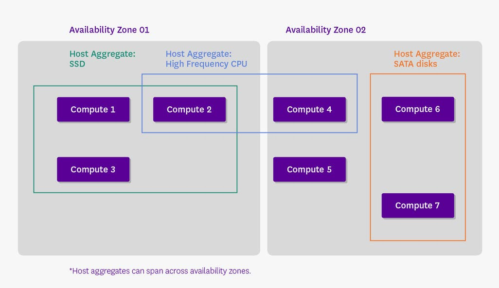

---
# Working with custom resources


```bash
# ✨ Create a new resource class                                            📋
openstack resource class create CUSTOM_GPU_DEMO

# ✨ Create a new resource provider
openstack resource provider list
openstack resource provider create --parent-provider <rp-uuid> compute11_gpu0
openstack resource provider inventory set <new-rp-uuid> \
  --resource CUSTOM_GPU_DEMO:max_unit=2 --resource CUSTOM_GPU_DEMO:total=2

# 🩺 Check
openstack resource provider list
openstack resource provider inventory list <new-rp-uuid>

# Create a new flavor
openstack flavor create gpu.tiny --vcpus 1 --ram 512 --disk 1
openstack flavor set gpu.tiny --property resources:CUSTOM_GPU_DEMO=1

# 🚀 Deploy a server
openstack server create --flavor gpu.tiny --image cirros --network demo-net gpu-vm1

# 🩺 Check the allocation
openstack server list  --long --all
openstack resource provider usage show 77a535e1-58c1-44c0-acca-fbe2d6cc00d3

```
---
# Links
- [OpenStack - Docs](https://docs.openstack.org)
- [OpenStack - Configuration Guides](https://docs.openstack.org/latest/configuration/)
- [OpenStack - Releases](https://releases.openstack.org/)
<br/>
- [OpenStack - Horizon / Dashboard](http://int.os.lab.nfgd.net)
- [OpenStack - Skyline / Dashboard](http://int.os.lab.nfgd.net:9999)
- [OpenStack - Grafana / Monitoring](http://int.os.lab.nfgd.net:3000)
- [OpenStack - Prometheus / Monitoring](http://int.os.lab.nfgd.net:9091)
- [OpenStack - Alertmanager](http://int.os.lab.nfgd.net:9093)

---
# Links
- [Cloud-Init - Docs](https://docs.cloud-init.io/en/latest/reference/examples.html)
<br/>
- [Harbor - Registry](http://registry.lab.nfgd.net/)

---

# Feedback and contributions

Found an error or want to contribute? Open a PR on [GitHub](https://github.com/infraguide-org/lab-openstack/tree/main).

More labs and cheat sheets: [infraguide.org](https://infraguide.org)

Questions or ideas: ping@infraguide.org
